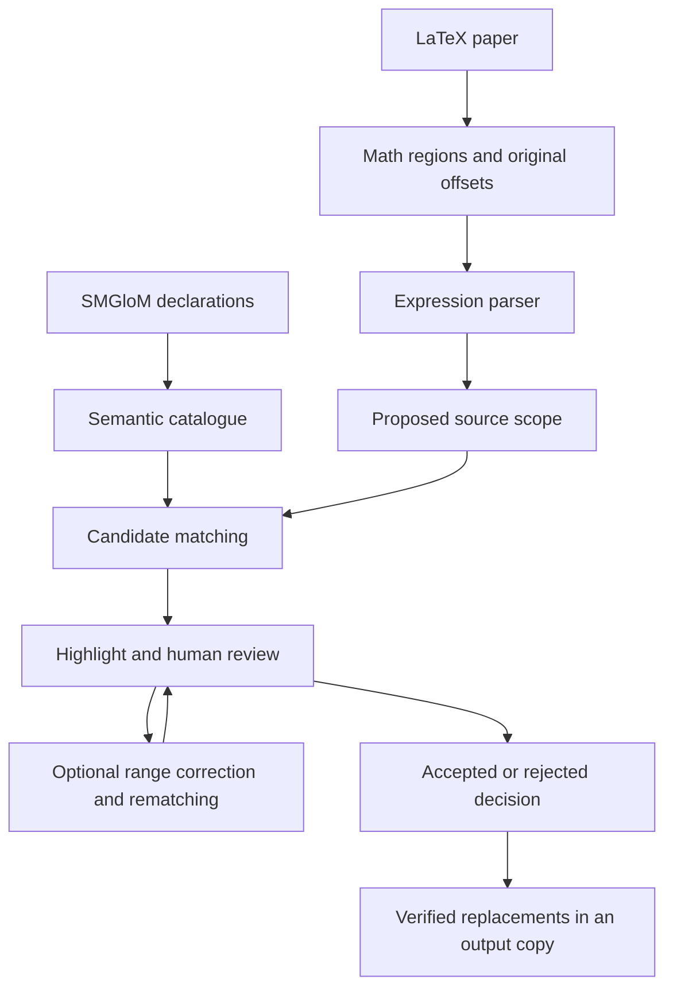

# Thesis implementation: eight core files

The runtime has one mathematical expression parser and one semantic matching path. Structural parsing determines source scope; SMGloM and explicitly supplied configuration provide possible meanings. A human confirms both the range and the meaning before an annotation is saved.



## Reading order

| Order | File | Responsibility | Important functions | Physical LOC |
|---|---|---|---|---:|
| 1 | `src/review_workflow.py` | Follow the complete interactive review, range correction, and decision persistence. | `main`, `run_generic_review`, `choose_review_range`, `recompute_review_scope`, `build_review_decision`, `save_decisions` | 649 |
| 2 | `src/expression_document.py` | Read papers, ignore comments, extract math, and retain original document locations. | `extract_math_regions`, `parse_papers`, `find_ast_occurrences`, `find_structural_occurrences` | 394 |
| 3 | `src/expression_parser.py` | Tokenize and parse mathematical structure using explicit grammar metadata. | `NotationRegistry.from_config`, `tokenize`, `ExpressionParser.parse`, `Expression.walk` | 962 |
| 4 | `src/smglom_notation_extractor.py` | Read real SMGloM declarations and their argument, notation, and module metadata. | `discover_repositories`, `parse_symdef`, `parse_notation`, `scan_available_smglom` | 604 |
| 5 | `src/notation_catalog.py` | Classify declarations, build a searchable catalogue, and compile configured grammar. | `classify_notation`, `build_catalog`, `search_catalog`, `annotation_candidates`, `build_expression_config` | 1,224 |
| 6 | `src/expression_annotation.py` | Match complete AST scopes, check proposal eligibility, and rank candidate dictionaries. | `match_candidate`, `match_classification`, `proposal_eligibility`, `rank_candidates` | 358 |
| 7 | `src/review_scope.py` | Turn matches into review cards and offer complete alternative ranges. | `build_review_scopes`, `render_review_scope`, `scope_alternatives`, `match_for_alternative` | 413 |
| 8 | `src/apply_annotations.py` | Validate saved choices and compose safe replacements in copied papers. | `validate_decisions`, `build_application_plan`, `render_application_plan`, `main` | 512 |

These eight files contain 5,116 physical lines. They are enough to follow the thesis algorithm. The supporting evaluation and diagnostic commands are separate.

## The actual main execution path in eight steps

The CLI initially asks for a notation or search term and loads its candidate shortlist. It then parses the paper before proposing any source range; candidate lookup is repeated after a corrected range when necessary.

| Step | File and function | Input | Output |
|---|---|---|---|
| 1. Find possible meanings | `review_workflow.main` / `find_generic_candidates` / `find_expression_candidates`; `notation_catalog.build_catalog` | Search term, installed SMGloM, optional JSON configuration | Candidate dictionaries |
| 2. Read the paper and find math | `expression_document.parse_papers` / `extract_math_regions` | TeX file or directory | Math regions with original offsets |
| 3. Parse structure | `expression_parser.ExpressionParser.parse` | Math source and registry | Generic `Expression` tree |
| 4. Find compatible scopes | `expression_annotation.match_candidate`; `expression_document.find_ast_occurrences` | Tree and classified candidates | Complete matched ranges and arguments |
| 5. Show the proposal | `review_scope.build_review_scopes` / `render_review_scope` | Matches and ranked candidates | Original formula, exact highlight, structure, arguments, choices |
| 6. Confirm or correct the range | `review_workflow.choose_review_range` / `recompute_review_scope` | Suggested range and human choice | Updated range, arguments, and candidates |
| 7. Save the human decision | `review_workflow.build_review_decision` / `save_decisions` | Accepted/rejected candidate and actual selected scope | Decision JSON |
| 8. Apply accepted choices | `apply_annotations.main` / `validate_decisions` / `render_application_plan` | Accepted decisions and unchanged original source | Annotated output copies and conflict report |

Step 8 is a separate command. Preview review writes no decisions.

## The data that matters

- `Expression` has a kind, start/end, value/notation, children, and roles. Its text is derived from its source slice. Metadata describes grammar; it does not prove a mathematical meaning.
- A candidate is a dictionary containing semantic identity, notation classification, source, and any required argument mapping. Ranking adds scores and evidence consumed by review and evaluation.
- `ReviewItem` is the single review record. Alternatives are small dictionaries referring to complete AST nodes and their document ranges.
- A saved decision has one document range: `start` and `end`. It retains the chosen macro/module, arguments, decision state, configuration when needed, and a hash of the original source slice.
- A planned replacement retains the verified original slice and replacement text. Parent/child links support nested annotations and overlap detection.

Parser offsets are relative to a math region. Occurrence offsets are absolute in the document. This difference is intentional; it is not a second persisted decision format.

## Configuration and supported scope

The optional JSON configuration format is shared by runtime and tests. `expression-config.example.json` configures structure. SMGloM supplies real semantic declarations. `integral-config.example.json` explicitly supplies synthetic integral semantics for examples; it does not claim a real installed calculus declaration. Synthetic test configurations remain labelled as test data.

The supported subset includes precedence, groups, scripts, functions, configured sequences and relations, Unicode, sums/binders/integrals, and source-preserving unknown-command fallback. Unknown semantics produce structural review without a fabricated annotation. Unsafe or unparsed scopes produce no proposal. Existing sized absolute-value delimiter limitations remain explicit.

Range correction uses complete AST nodes and validated alternative boundaries. It cannot select an arbitrary incomplete TeX substring. Matching and ranking run again for the selected range, so an old candidate cannot survive solely because the highlight changed.

## Supporting modules

| File | Classification | Why it remains |
|---|---|---|
| `evaluate_corpus.py` | Evaluation/reproducibility | Aggregates the three-document corpus, semantic denominators, readiness, and error analysis. |
| `evaluate_workflow.py` | Evaluation/reproducibility | Builds per-document evaluation records and scope/ranking metrics; used by the corpus evaluator. |
| `evaluate_generalization.py` | Evaluation/reproducibility | Exercises structural generalization cases used by regression tests. |
| `evaluate_unicode_stress.py` | Evaluation/reproducibility | Checks Unicode cases and deterministic stress inputs used by tests. |
| `smglom_dependencies.py` | Evaluation/reproducibility | Checks installed repositories, dependencies, and portable snapshots. |
| `project_status.py` | Evaluation/reproducibility | Prints project and corpus status from those existing computations. |
| `parser_diagnostics.py` | CLI/debug utility | Explains unsupported math and parser coverage for the review diagnostics option. |
| `inspect_expression.py` | CLI/debug utility | Shows the structure and offsets of one expression or a TeX file. |
| `validate_decisions.py` | CLI utility | Preserves the documented validation command as a seven-line entry point into application validation. |

The migration tool under `tools/` is optional and never imported by normal runtime. It is retained to explain and reproduce the one-time historical decision conversion.

## Reproducibility and safe commands

```powershell
py -3.10 -m unittest discover -s tests -v
py -3.10 src\inspect_expression.py "a+b*c"
py -3.10 src\review_workflow.py --paper tests\fixtures\review_scope_cases.tex --preview
py -3.10 src\validate_decisions.py --symbol=-
py -3.10 src\apply_annotations.py --check-conflicts
py -3.10 src\evaluate_corpus.py --corpus evaluation\corpus.json --output evaluation\verification
py -3.10 src\project_status.py
py -3.10 src\smglom_dependencies.py --check
```

The evaluator uses frozen review evidence, independently of interactive history. Gold labels and frozen result files are not rewritten during simplification. Read `SIMPLIFICATION_REPORT.md` for the final counts, checks, and historical application-count qualification.
